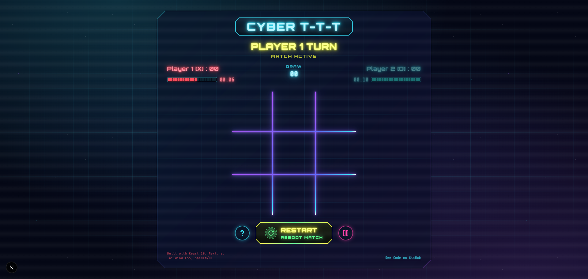
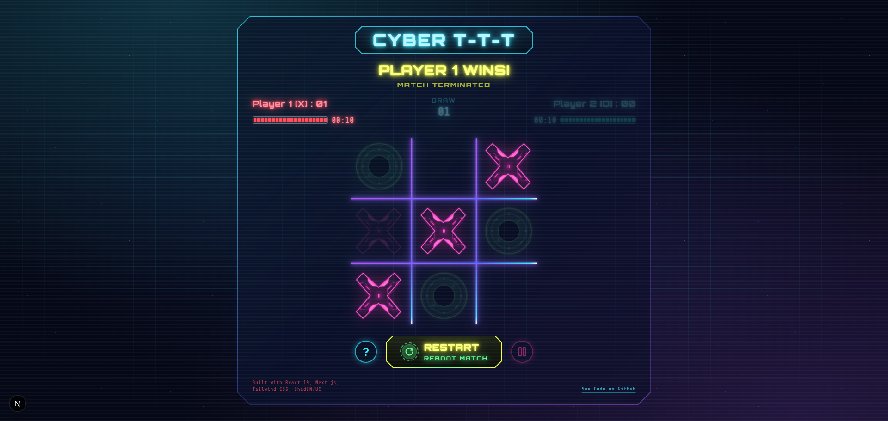
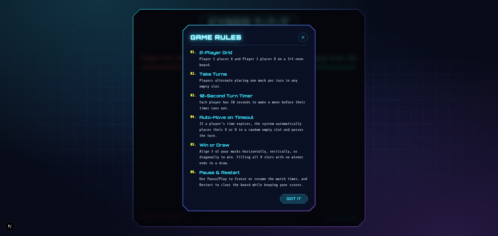

# CYBER T-T-T — Cyberpunk Tic-Tac-Toe

A fast-paced, two-player **Tic-Tac-Toe** game with a neon cyberpunk HUD, turn countdown timers, glitch-light animations, and an anti-cheat pause shield. Built for local head-to-head play and ready to deploy straight to Vercel.

---

## Screenshots

### Match Start


### Player 1 Wins


### Rules Modal


---

## About & Built With

**CYBER T-T-T** reimagines classic 3×3 Tic-Tac-Toe inside a chamfered neon HUD with animated circuit grid lines, segmented countdown bars, glitch-light mark entrances, and persistent round scores (including draws).

### Tech Stack
- **[Next.js 16](https://nextjs.org/)** (App Router) & **[React 19](https://react.dev/)**
- **[TypeScript](https://www.typescriptlang.org/)**
- **[Tailwind CSS v4](https://tailwindcss.com/)** (custom neon utilities, chamfered panels, and keyframe animations)
- **[shadcn/ui](https://ui.shadcn.com/)** (`Button` primitive with `class-variance-authority` and `tailwind-merge`)
- **[Lucide React](https://lucide.dev/)** (UI icons)
- **Google Fonts** (`Orbitron` & `Share Tech Mono` via `next/font/google`)

### Project Structure
```text
app/
  layout.tsx                  # Fonts, metadata, and dark theme setup
  page.tsx                    # Entry page rendering CyberTicTacToe
  globals.css                 # Tailwind v4 theme tokens, neon glows, and animations
components/
  game/
    cyber-tic-tac-toe.tsx     # Main HUD, game state, timer loop, and controls
    game-board.tsx            # 3×3 neon grid, X/O image marks, and win/draw blink
    player-panel.tsx          # Player scoreboards and 10s segmented timers
    restart-button.tsx        # Chamfered Restart / Reboot Match button
    pause-modal.tsx           # Anti-cheat overlay that cloaks the board when paused
    restart-modal.tsx         # Confirmation modal before rebooting an active match
    rules-modal.tsx           # In-game rules dialog
  ui/
    button.tsx                # shadcn/ui Button component
lib/
  game.ts                     # Game reducer, win/draw detection, and turn timer logic
  utils.ts                    # shadcn/ui `cn` class helper
public/img/                   # Served X and O mark assets (x.png, o.png)
```

---

## How to Play & Rules

1. **2-Player Grid:** **Player 1 (`X`)** and **Player 2 (`O`)** compete on a 3×3 neon board.
2. **Take Turns:** Players alternate placing one mark per turn in any empty slot.
3. **10-Second Turn Timer:** Each player has **10 seconds** per turn. The segmented bar turns yellow and flashes during the final 3 seconds.
4. **Auto-Move on Timeout:** If a player's timer hits `00:00`, the system automatically places their `X` or `O` in a random empty slot and passes the turn.
5. **Win or Draw:**
   - Align **3 marks** horizontally, vertically, or diagonally to win — the winning combination blinks, the losing marks dim, and the winner's score increments.
   - Filling all 9 slots with no winner triggers a **Draw** (`System deadlock`), blinking all marks and incrementing the center `DRAW` counter.
6. **Controls:**
   - **`?` (Rules):** Opens the rules modal and pauses the timer while open.
   - **Pause / Play:** Freezes the timer and opens the **Anti-Cheat Shield** modal, cloaking the board so players cannot peek or plot moves while paused.
   - **Restart (`Reboot Match`):** Clears the board for the next round while preserving Player 1, Draw, and Player 2 scores. Mid-match restarts ask for confirmation; terminated matches restart immediately.

> Want a different turn duration? Update `TURN_MS` in [`lib/game.ts`](lib/game.ts).

---

## Installation

### Prerequisites
- **Node.js** 18.18+ (or 20+ recommended)
- **npm**

### Run Locally
```bash
# 1. Clone the repository
git clone https://github.com/LaylKnight/cyber-tik-tak-toe-game.git
cd cyber-tik-tak-toe-game

# 2. Install dependencies
npm install

# 3. Start the development server
npm run dev
```
Open **http://localhost:3000** in your browser.

### Production Build
```bash
npm run build
npm run start
```

---

## Deploy to Vercel

**Option A: Git Integration (Recommended)**
1. Push this repository to GitHub, GitLab, or Bitbucket.
2. Go to [vercel.com/new](https://vercel.com/new) and import the repository.
3. Vercel automatically detects Next.js — keep the default settings and click **Deploy**.

**Option B: Vercel CLI**
```bash
npm i -g vercel
vercel          # preview deployment
vercel --prod   # production deployment
```

No environment variables or `vercel.json` configuration are required.
